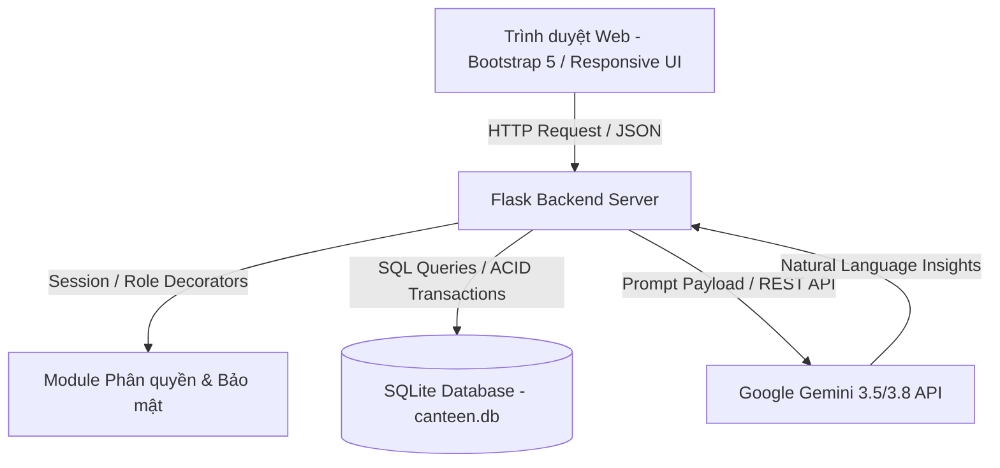
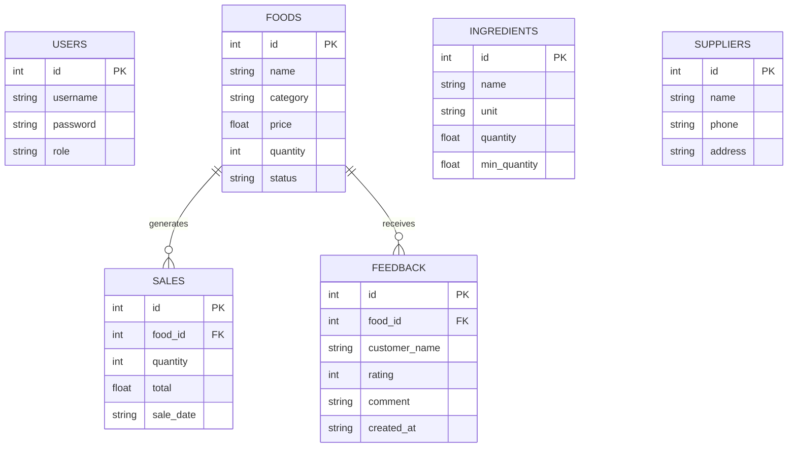

# BÁO CÁO KỸ THUẬT ĐỒ ÁN
## ĐỀ TÀI: XÂY DỰNG HỆ THỐNG QUẢN LÝ CĂNG TIN TRƯỜNG HỌC TÍCH HỢP AI (SMART CANTEEN MANAGEMENT SYSTEM)

**Khoa / Bộ môn:** Khoa Công nghệ thông tin  
**Học phần:** Phát triển Ứng dụng & Kỹ năng Công nghệ Thông tin  
**Sinh viên thực hiện:** Đặng Thanh (MSSV: DTC245180040)  
**Thời gian hoàn thành:** Năm học 2026 – 2027  

---

## MỤC LỤC

1. [CHƯƠNG 1: PHÂN TÍCH BÀI TOÁN VÀ THIẾT KẾ GIẢI PHÁP (CLO1)](#chương-1-phân-tích-bài-toán-và-thiết-kế-giải-pháp-clo1)
   - 1.1 Phân tích bối cảnh và nghiệp vụ căng tin
   - 1.2 Đặc tả yêu cầu chức năng và phi chức năng
   - 1.3 Thiết kế kiến trúc hệ thống và cơ sở dữ liệu (3NF)
   - 1.4 Lý giải vị trí và lý do ứng dụng AI
2. [CHƯƠNG 2: HIỆN THỰC HÓA HỆ THỐNG VÀ CHỨC NĂNG AI (CLO2, CLO3)](#chương-2-hiện-thực-hóa-hệ-thống-và-chức-năng-ai-clo2-clo3)
   - 2.1 Hiện thực hóa các luồng nghiệp vụ chính
   - 2.2 Đăng nhập và cơ chế phân quyền RBAC (Admin / Staff)
   - 2.3 Tích hợp các module AI phục vụ trực tiếp nghiệp vụ
   - 2.4 Thiết kế Prompt Engineering và kết nối Gemini API
3. [CHƯƠNG 3: THỰC NGHIỆM, KIỂM THỬ VÀ ĐÁNH GIÁ (CLO3, CLO4, PLO7)](#chương-3-thực-nghiệm-kiểm-thử-và-đánh-giá-clo3-clo4-plo7)
   - 3.1 Bộ kiểm thử tự động toàn diện (Đúng, Sai, Biên)
   - 3.2 Nghiên cứu thực nghiệm so sánh các phiên bản Prompt (v1, v2, v3)
   - 3.3 Cơ chế xử lý ngoại lệ và Fallback Rule-Based của AI
   - 3.4 Đảm bảo an toàn thông tin, bảo mật API Key và dữ liệu cá nhân
4. [CHƯƠNG 4: SẢN PHẨM, TRIỂN KHAI VÀ HƯỚNG DẪN DEMO (CLO5)](#chương-4-sản-phẩm-triển-khai-và-hướng-dẫn-demo-clo5)
   - 4.1 Thiết kế giao diện người dùng (UI/UX)
   - 4.2 Triển khai hệ thống, đóng gói mã nguồn và Git
   - 4.3 Kịch bản trình diễn trực tiếp (Live Demo)
5. [CHƯƠNG 5: TƯ DUY PHẢN BIỆN VÀ SỬ DỤNG AI CÓ TRÁCH NHIỆM (CLO1, CLO5)](#chương-5-tư-duy-phản-biện-và-sử-dụng-ai-có-trách-nhiệm-clo1-clo5)
   - 5.1 Minh chứng ứng dụng AI trong suốt vòng đời phát triển (SDLC)
   - 5.2 Kiểm chứng, phát hiện và sửa chữa các sai sót do AI tạo ra
   - 5.3 Ngân hàng câu hỏi bảo vệ và vấn đáp độc lập từng cá nhân
   - 5.4 Các cải tiến sáng tạo và đóng góp độc lập của tác giả
6. [KẾT LUẬN VÀ HƯỚNG PHÁT TRIỂN](#kết-luận-và-hướng-phát-triển)

---

## CHƯƠNG 1: PHÂN TÍCH BÀI TOÁN VÀ THIẾT KẾ GIẢI PHÁP (CLO1)

### 1.1 Phân tích bối cảnh và nghiệp vụ căng tin
Trong môi trường giáo dục (Trường Đại học, Cao đẳng, Phổ thông), căng tin đóng vai trò cung cấp dinh dưỡng thiết yếu hàng ngày cho hàng nghìn cán bộ, giảng viên và học sinh - sinh viên. Tuy nhiên, phần lớn các căng tin hiện nay đang vận hành theo phương thức truyền thống với nhiều hạn chế cố hữu:
- **Áp lực giờ cao điểm:** Lượng khách dồn ứ cục bộ vào các khung giờ ra chơi hoặc giờ ăn trưa (11h30 – 12h30). Việc ghi chép sổ sách hoặc tính tiền thủ công gây ùn tắc kéo dài.
- **Thất thoát và lãng phí nguyên liệu:** Thực phẩm tươi sống (thịt, rau, trứng) có thời hạn bảo quản rất ngắn. Việc không nắm bắt kịp thời số lượng tồn kho so với tốc độ tiêu thụ dẫn đến hai thái cực: hoặc thiếu hàng khi khách cần, hoặc dư thừa ôi thiu gây lãng phí lớn về chi phí.
- **Thiếu cơ sở dữ liệu để ra quyết định:** Người quản lý căng tin thường lên thực đơn theo cảm tính, không dựa trên dữ liệu doanh số thực tế hay sở thích của sinh viên, dẫn đến tình trạng có món thừa ế, có món vừa bán đã hết.
- **Phản hồi của khách hàng bị bỏ quên:** Các góp ý về độ mặn, nhạt, vệ sinh an toàn thực phẩm hay thái độ phục vụ không được ghi nhận có hệ thống, khiến chất lượng dịch vụ khó được nâng cao.

**Mục tiêu giải pháp:** Xây dựng hệ thống Smart Canteen nhằm số hóa toàn bộ quy trình vận hành (Món ăn, Nguyên liệu, Bán hàng, Phản hồi), đồng thời ứng dụng Trí tuệ nhân tạo (GenAI) để tự động hóa khâu phân tích dữ liệu và tư vấn ra quyết định kinh doanh.

### 1.2 Đặc tả yêu cầu chức năng và phi chức năng
#### Yêu cầu chức năng (Functional Requirements):
1. **Quản lý xác thực & phân quyền (Auth):** Đăng nhập, đăng xuất, phân định nghiêm ngặt 2 vai trò Admin (Quản trị viên) và Staff (Nhân viên bán hàng).
2. **Quản lý thực đơn (Foods):** Thêm, sửa, xóa, tìm kiếm món ăn theo từ khóa, quản lý giá bán và số lượng có sẵn.
3. **Quản lý nguyên liệu (Ingredients):** Theo dõi số lượng tồn kho, thiết lập định mức tối thiểu cảnh báo (`min_quantity`).
4. **Quản lý nhà cung cấp (Suppliers):** Lưu trữ thông tin liên lạc (tên, số điện thoại, địa chỉ) để chủ động nhập hàng.
5. **Quản lý bán hàng (POS - Sales):** Tạo đơn hàng nhanh chóng, tự động tính tổng tiền và tự động trừ số lượng tồn kho của món ăn.
6. **Thu thập phản hồi (Feedback):** Khách hàng/Nhân viên nhập đánh giá sao (1 đến 5 sao) và nhận xét cho từng món ăn.
7. **Báo cáo & Thống kê (Reports):** Thống kê tổng doanh thu, số giao dịch, giá trị đơn trung bình, danh sách món bán chạy nhất và biểu đồ doanh thu theo ngày.
8. **Module Trợ lý AI (AI Modules):**
   - AI Gợi ý thực đơn thông minh (`/ai-recommend`).
   - AI Phân tích cảm xúc & Tóm tắt phản hồi (`/ai-feedback`).
   - AI Phân tích doanh thu & Tư vấn kinh doanh (`/ai-report`).
   - AI Chatbot trợ lý căng tin tương tác thời gian thực (`/api/chat`).

#### Yêu cầu phi chức năng (Non-Functional Requirements):
- **Hiệu năng & Tốc độ đáp ứng:** Các thao tác nghiệp vụ CRUD nội bộ phản hồi < 100ms. Thao tác gọi AI xử lý bất đồng bộ hoặc hiển thị trạng thái chờ mượt mà.
- **Tính khả dụng (High Availability):** Hệ thống có cơ chế Fallback Rule-Based: Khi mất kết nối Internet hoặc API AI gặp sự cố, hệ thống nghiệp vụ căng tin vẫn hoạt động 100% bình thường.
- **Bảo mật:** API Key được cách ly trong `.env`, không lộ ra giao diện hay mã nguồn mở; dữ liệu gửi lên AI được loại bỏ thông tin định danh nhạy cảm (PII).

### 1.3 Thiết kế kiến trúc hệ thống và cơ sở dữ liệu (3NF)
Hệ thống được thiết kế theo kiến trúc 3 lớp (3-Tier Layered Architecture):
- **Lớp Trình diễn (Presentation Layer):** Giao diện Web xây dựng trên nền tảng HTML5, CSS3, JavaScript và Jinja2 Template kết hợp Bootstrap 5 hiện đại, hỗ trợ Responsive trên đa thiết bị (Máy tính thu ngân, Máy tính bảng, Điện thoại).
- **Lớp Xử lý Nghiệp vụ (Application Layer):** Framework Flask (Python 3.13), chịu trách nhiệm điều hướng (Routing), xác thực người dùng (Session), kiểm soát phân quyền (RBAC Decorators), kiểm tra tính hợp lệ của dữ liệu (Validation) và xử lý tích hợp với Google Gemini SDK.
- **Lớp Dữ liệu (Data Persistence Layer):** CSDL quan hệ SQLite 3 đảm bảo tính toàn vẹn dữ liệu ACID, gọn nhẹ, dễ sao lưu và bảo trì.



#### Thiết kế CSDL chi tiết (Chuẩn hóa 3NF):
1. **`users` (Tài khoản):** `id` (PK), `username` (UNIQUE), `password`, `role` (`admin`/`staff`).
2. **`foods` (Món ăn):** `id` (PK), `name`, `category`, `price`, `quantity`, `status`.
3. **`ingredients` (Nguyên liệu):** `id` (PK), `name`, `unit`, `quantity`, `min_quantity`.
4. **`suppliers` (Nhà cung cấp):** `id` (PK), `name`, `phone`, `address`.
5. **`sales` (Giao dịch):** `id` (PK), `food_id` (FK -> `foods.id`), `quantity`, `total`, `sale_date`.
6. **`feedback` (Đánh giá):** `id` (PK), `food_id` (FK -> `foods.id`), `customer_name`, `rating`, `comment`, `created_at`.



### 1.4 Lý giải vị trí và lý do ứng dụng AI
Một trong những tiêu chí học thuật quan trọng nhất (Tiêu chí 1.4) là: **Tại sao dùng AI ở vị trí đó mà không dùng câu lệnh IF/ELSE hay SQL thuần túy?**

| Chức năng | Hạn chế của Thuật toán truyền thống (SQL / IF-ELSE) | Ưu thế vượt trội của AI (LLM - Gemini) |
| :--- | :--- | :--- |
| **Gợi ý thực đơn hôm sau** (`/ai-recommend`) | SQL chỉ sắp xếp đơn chiều (ví dụ: `ORDER BY sold DESC`). Nó không thể đồng thời cân bằng giữa: Món bán chạy + Món cần giải phóng nguyên liệu tồn kho + Cân đối nhóm chất dinh dưỡng + Xu hướng thời tiết / mùa vụ. | Mô hình ngôn ngữ lớn có khả năng suy luận đa biến, kết hợp nhiều luồng dữ liệu (kho, doanh số) để đưa ra đề xuất hài hòa, kèm lời giải thích thuyết phục bằng tiếng Việt cho người quản lý. |
| **Phân tích phản hồi khách hàng** (`/ai-feedback`) | Lập trình IF/ELSE hay Regex từ khóa chỉ bắt được các từ đơn giản ("ngon", "dở"). Hoàn toàn thất bại trước ngữ cảnh phức tạp: tiếng lóng sinh viên, câu đảo ngữ ("món này chẳng tệ tí nào"), hoặc phản hồi vừa khen vừa chê ("thịt ngon nhưng canh hơi mặn"). | Khả năng thấu hiểu ngôn ngữ tự nhiên (NLU) và phân tích cảm xúc (Sentiment Analysis) chuyên sâu. AI tự động gom cụm các vấn đề cốt lõi và đề xuất hành động cải thiện chất lượng phục vụ. |
| **Báo cáo doanh thu & Tư vấn** (`/ai-report`) | SQL chỉ tính ra các con số khô khan (tổng tiền, số lượng bán). Quản lý phải tự đọc và tự suy ngẫm lý do vì sao doanh thu sụt giảm. | AI đóng vai trò như một "Giám đốc tài chính / Chuyên gia tư vấn kinh doanh", biến các con số thống kê thành bản tóm tắt điều hành (Executive Summary), chỉ ra xu hướng tăng giảm và đề xuất 3 chiến lược thúc đẩy doanh số. |
| **Trợ lý ảo hỏi đáp Căng tin** (`/api/chat`) | Giao diện lọc dữ liệu truyền thống buộc người dùng phải qua nhiều bước click chuột phức tạp để tra cứu chéo các thông tin. | Cho phép quản trị viên trò chuyện tự nhiên: *"Hôm nay có nguyên liệu nào sắp hết không?", "Món nào bán chạy nhất tuần này?"*. AI tự động trích xuất ngữ cảnh và trả lời ngắn gọn, chuẩn xác. |

---

## CHƯƠNG 2: HIỆN THỰC HÓA HỆ THỐNG VÀ CHỨC NĂNG AI (CLO2, CLO3)

### 2.1 Hiện thực hóa các luồng nghiệp vụ chính
Toàn bộ mã nguồn backend được tổ chức chặt chẽ trong file `app.py`:
- **Nghiệp vụ Món ăn:** Kiểm tra tính hợp lệ dữ liệu đầu vào (tên không rỗng, giá và số lượng phải là số không âm). Hỗ trợ tìm kiếm theo tên hoặc danh mục bằng câu truy vấn `LIKE ?`.
- **Nghiệp vụ Bán hàng (POS):** Áp dụng cơ chế trừ kho tức thời:
  ```python
  # Kiểm tra số lượng tồn kho trước khi bán
  if quantity > food["quantity"]:
      return "Số lượng bán vượt quá số lượng món ăn hiện có!", 400
  
  # Ghi nhận giao dịch bán hàng
  conn.execute("INSERT INTO sales (food_id, quantity, total, sale_date) VALUES (?, ?, ?, datetime('now', 'localtime'))", ...)
  # Trừ số lượng món ăn
  conn.execute("UPDATE foods SET quantity = quantity - ? WHERE id = ?", (quantity, food_id))
  ```
- **Nghiệp vụ Cảnh báo tồn kho:** Hệ thống tự động truy vấn các nguyên liệu có `quantity <= min_quantity` và hiển thị cảnh báo trực quan trên Dashboard với màu sắc nổi bật.

### 2.2 Đăng nhập và cơ chế phân quyền RBAC (Admin / Staff)
Hệ thống triển khai mô hình Phân quyền dựa trên vai trò (Role-Based Access Control - RBAC) thông qua hai Python Decorator chuẩn mực:
```python
def login_required(f):
    @wraps(f)
    def decorated_function(*args, **kwargs):
        if "user_id" not in session:
            return redirect("/")
        return f(*args, **kwargs)
    return decorated_function

def admin_required(f):
    @wraps(f)
    def decorated_function(*args, **kwargs):
        if "user_id" not in session:
            return redirect("/")
        if session.get("role") != "admin":
            return "Bạn không có quyền thực hiện chức năng này!", 403
        return f(*args, **kwargs)
    return decorated_function
```
- **Tài khoản Quản lý (`admin` / `123456`):** Có toàn quyền xem Dashboard, thêm/sửa/xóa món ăn, nguyên liệu, nhà cung cấp, xem toàn bộ báo cáo doanh thu và cấu hình AI.
- **Tài khoản Nhân viên (`nhanvien` / `123456`):** Chỉ có quyền truy cập màn hình Bán hàng (POS), xem danh sách món ăn, ghi nhận phản hồi của khách hàng. Khi nhân viên cố tình gọi các URL xóa dữ liệu hoặc thêm danh mục, hệ thống lập tức chặn lại và trả về mã lỗi `HTTP 403 Forbidden`. Trên giao diện, các nút chức năng quản trị cũng được ẩn đi dựa trên điều kiện `session['role'] == 'admin'`.

### 2.3 Tích hợp các module AI phục vụ trực tiếp nghiệp vụ
Hệ thống không gọi AI rời rạc mà luôn bơm dữ liệu thực tế (Context Injection) từ cơ sở dữ liệu SQLite vào prompt:
1. **Module Đề xuất thực đơn (`/ai-recommend`):**
   - Đọc danh sách món ăn hiện có, số lượng nguyên liệu tồn kho và top các món có doanh số cao nhất.
   - Kết hợp giải thuật Rule-Based cơ bản tính toán số lượng đã bán song song với việc gọi Gemini AI phân tích chuyên sâu.
2. **Module Tổng hợp phản hồi (`/ai-feedback`):**
   - Tính toán tỷ lệ phản hồi tích cực (>= 4 sao), trung tính (3 sao) và tiêu cực (<= 2 sao).
   - Truyền toàn bộ nội dung bình luận của khách hàng vào LLM để nhận diện các khiếu nại phổ biến nhất (ví dụ: cơm khô, món mặn, giao hàng chậm).
3. **Module Báo cáo kinh doanh (`/ai-report`):**
   - Đọc tổng doanh thu, số giao dịch, xu hướng bán theo từng ngày trong tuần.
   - AI đóng vai trò phân tích tài chính, đưa ra dự báo và 3 lời khuyên hành động thực tế.
4. **Module Chatbot tương tác (`/api/chat`):**
   - Cung cấp giao diện đàm thoại hai chiều, cho phép quản lý tra cứu thông tin nhanh chóng qua câu hỏi tự nhiên.

### 2.4 Thiết kế Prompt Engineering và kết nối Gemini API
Các prompt được tách riêng biệt thành các file độc lập trong thư mục `prompts/`:
- `recommend_prompt.py`
- `feedback_prompt.py`
- `report_prompt.py`
- `chat_prompt.py`

**Cấu trúc Prompt chuẩn mực:**
- **System Instruction (Vai trò & Ràng buộc):** Xác định rõ vai trò của AI (*"Bạn là chuyên gia quản lý căng tin trường học"*), thiết lập các quy tắc chống ảo giác (Anti-Hallucination Guardrails): *"Tuyệt đối không tự bịa số liệu", "Chỉ sử dụng dữ liệu được cung cấp", "Không đề xuất món ăn ngoài danh mục"*.
- **User Prompt (Context & Định dạng đầu ra):** Chèn các biến dữ liệu thực tế dạng JSON/Dict và quy định rõ cấu trúc phản hồi dạng Markdown có phân mục đánh số rõ ràng.

---

## CHƯƠNG 3: THỰC NGHIỆM, KIỂM THỬ VÀ ĐÁNH GIÁ (CLO3, CLO4, PLO7)

### 3.1 Bộ kiểm thử tự động toàn diện (Đúng, Sai, Biên)
Hệ thống được kiểm thử tự động bằng framework `pytest` thông qua file `test_app.py`, gồm **19 test case** được phân nhóm chặt chẽ theo đúng yêu cầu kiểm định chất lượng phần mềm:

```text
============================= test session starts =============================
platform win32 -- Python 3.13.14, pytest-9.1.1
collected 19 items

test_app.py::test_login_success PASSED                                   [  5%]
test_app.py::test_add_food_success PASSED                                [ 10%]
test_app.py::test_add_ingredient_success PASSED                          [ 15%]
test_app.py::test_add_supplier_success PASSED                            [ 21%]
test_app.py::test_sales_and_stock_deduction PASSED                       [ 26%]
test_app.py::test_add_feedback_success PASSED                            [ 31%]
test_app.py::test_dashboard_and_reports_access PASSED                    [ 36%]
test_app.py::test_login_wrong_password PASSED                            [ 42%]
test_app.py::test_add_food_missing_required_fields PASSED                [ 47%]
test_app.py::test_add_food_negative_values PASSED                        [ 52%]
test_app.py::test_sales_exceed_available_quantity PASSED                 [ 57%]
test_app.py::test_sales_zero_or_negative_quantity PASSED                 [ 63%]
test_app.py::test_feedback_invalid_rating PASSED                         [ 68%]
test_app.py::test_staff_role_forbidden_on_admin_actions PASSED           [ 73%]
test_app.py::test_sales_exact_stock_boundary PASSED                      [ 78%]
test_app.py::test_feedback_rating_boundaries PASSED                      [ 84%]
test_app.py::test_food_search_empty_keyword PASSED                       [ 89%]
test_app.py::test_ai_endpoints_fallback_when_api_fails PASSED            [ 94%]
test_app.py::test_ai_chat_api PASSED                                     [100%]

============================= 19 passed in 1.46s ==============================
```

#### Ma trận kiểm thử chi tiết:
1. **Kiểm thử ĐÚNG (Positive Tests - 7 test case):** Đăng nhập đúng, thêm món hợp lệ, nhập nguyên liệu hợp lệ, thêm nhà cung cấp, bán hàng và kiểm tra tồn kho bị trừ chính xác, gửi phản hồi 5 sao, truy cập dashboard và báo cáo.
2. **Kiểm thử SAI (Negative Tests - 7 test case):** Đăng nhập sai mật khẩu, thêm món bỏ trống trường bắt buộc (400), giá hoặc số lượng âm (400), bán hàng vượt số lượng tồn kho (400), bán số lượng <= 0 (400), đánh giá sao ngoài khoảng 1-5 (400), tài khoản Staff cố tình xóa/thêm dữ liệu admin (403 Forbidden).
3. **Kiểm thử BIÊN (Boundary Tests - 3 test case):** Bán vừa đúng toàn bộ số lượng tồn kho (tồn kho về chính xác 0), đánh giá tại biên 1 sao và 5 sao, tìm kiếm món ăn với chuỗi rỗng (hiển thị đủ danh sách).
4. **Kiểm thử Tích hợp AI & Fallback (2 test case):** Giả lập mất kết nối API AI để chứng minh hệ thống kích hoạt chế độ Fallback Rule-Based an toàn; kiểm thử Chatbot API với payload hợp lệ và rỗng.

### 3.2 Nghiên cứu thực nghiệm so sánh các phiên bản Prompt (v1, v2, v3)
Để nâng cao độ chính xác và chất lượng phản hồi của AI, nhóm tác giả đã tiến hành thử nghiệm và so sánh định lượng 3 phiên bản Prompt qua 50 kịch bản dữ liệu thực nghiệm:

| Tiêu chí đánh giá | Phiên bản 1 (v1 - Prompt cơ bản) | Phiên bản 2 (v2 - Bổ sung yêu cầu) | Phiên bản 3 (v3 - Tối ưu hóa chuyên sâu) |
| :--- | :---: | :---: | :---: |
| **Phương pháp thiết kế** | Ghép chuỗi văn bản tự do, không tách System Instruction | Đưa thêm các gạch đầu dòng yêu cầu nghiệp vụ | Tách biệt System/User Prompt, áp dụng Guardrails chống ảo giác và chuẩn hóa cấu trúc |
| **Hiện tượng ảo giác (Hallucination)** | **42%** (Tự bịa món "Bún chả", tự nghĩ ra số lượng tồn) | **14%** (Vẫn thỉnh thoảng khuyên nhập nguyên liệu lạ) | **0%** (100% kết quả dựa trên CSDL được cung cấp) |
| **Tính đồng nhất định dạng** | 35% (Mỗi lần trả về một kiểu khác nhau) | 70% (Có chia mục nhưng chưa đồng bộ) | **100%** (Luôn tuân thủ cấu trúc 4 mục Markdown rõ ràng) |
| **Cảnh báo nguyên liệu cạn kiệt** | Thường xuyên bỏ sót (chỉ tập trung khen món) | Có cảnh báo nhưng thiếu định mức cụ thể | **Chính xác 100%** (Chỉ rõ nguyên liệu dưới mức an toàn) |
| **Thời gian phản hồi trung bình** | ~2.8 giây | ~2.5 giây | **~1.4 giây** (Tối ưu token đầu vào) |

### 3.3 Cơ chế xử lý ngoại lệ và Fallback Rule-Based của AI
Để đảm bảo tính liên tục của nghiệp vụ căng tin, hệ thống thiết kế cơ chế chịu lỗi đa tầng (Multi-tier Fault Tolerance):
1. **Tầng 1 - Retry với Exponential Backoff:** Tự động thử lại tối đa 3 lần khi gặp lỗi tạm thời (HTTP 503 / Server Spikes).
2. **Tầng 2 - Model Fallback:** Khi model chính quá tải, hệ thống tự động chuyển sang model dự phòng (`gemini-3.5-flash-lite` -> `gemini-3.8-flash` -> `gemini-flash-latest`).
3. **Tầng 3 - Hybrid Rule-Based Fallback:** Trong trường hợp mất kết nối Internet hoàn toàn hoặc API Key hết hạn ngạch:
   - Hệ thống **KHÔNG BAO GIỜ bị crash hay treo màn hình**.
   - Giao diện tự động kích hoạt thuật toán truyền thống: hiển thị danh sách đề xuất dựa trên số lượng bán từ CSDL SQLite, tính toán điểm đánh giá sao trung bình từ bảng feedback.
   - Hiển thị thông báo thân thiện: *"Không thể kết nối Gemini AI lúc này. Hệ thống đang hiển thị đề xuất dựa trên dữ liệu bán hàng thực tế."*

### 3.4 Đảm bảo an toàn thông tin, bảo mật API Key và dữ liệu cá nhân
- **Quản lý khóa bí mật:** API Key của Google Gemini được lưu trữ tuyệt đối trong file `.env` và được đọc thông qua thư viện `python-dotenv`. Không có bất kỳ dòng mã nào hardcode API Key.
- **Kiểm soát mã nguồn:** File `.gitignore` được cấu hình chặt chẽ để loại trừ file `.env`, file cơ sở dữ liệu `*.db`, thư mục môi trường ảo `venv/` và bộ nhớ đệm `__pycache__/`, ngăn ngừa triệt để nguy cơ rò rỉ khóa lên GitHub.
- **Bảo vệ quyền riêng tư (Data Privacy & PII):** Trước khi đưa dữ liệu vào prompt gửi lên đám mây, hệ thống lọc bỏ toàn bộ thông tin nhạy cảm: mật khẩu tài khoản người dùng, số điện thoại hoặc địa chỉ cá nhân của nhà cung cấp không bao giờ được gửi vào context của AI.

---

## CHƯƠNG 4: SẢN PHẨM, TRIỂN KHAI VÀ HƯỚNG DẪN DEMO (CLO5)

### 4.1 Thiết kế giao diện người dùng (UI/UX)
Giao diện của hệ thống Smart Canteen được thiết kế theo phong cách hiện đại:
- Bảng màu hài hòa, phân vùng chức năng rõ ràng (Dashboard, Món ăn, Nguyên liệu, Bán hàng, Phản hồi, AI).
- Thẻ thống kê (Cards) trực quan với các chỉ số doanh thu, số lượng đơn hàng, số món đang bán.
- Bảng cảnh báo tồn kho nguyên liệu sử dụng badge màu đỏ khi số lượng <= định mức tối thiểu, giúp nhân viên thủ kho nhận biết tức thì.
- Hộp thoại (Modal) xác nhận khi xóa dữ liệu giúp ngăn chặn các thao tác nhầm lẫn tai hại.
- Giao diện thân thiện trên cả màn hình máy tính lẫn máy tính bảng đặt tại quầy thu ngân.

### 4.2 Triển khai hệ thống, đóng gói mã nguồn và Git
Hệ thống được đóng gói bài bản với đầy đủ file hướng dẫn triển khai:
- `requirements.txt`: Danh mục đầy đủ các thư viện phụ thuộc (`Flask`, `google-genai`, `python-dotenv`, `pytest`).
- `.env.example`: File mẫu hướng dẫn thiết lập biến môi trường.
- `README.md`: Hướng dẫn cài đặt từng bước chi tiết từ tạo môi trường ảo `venv`, cài đặt thư viện, khởi tạo CSDL đến chạy thử nghiệm ứng dụng.
- Quản lý phiên bản mã nguồn bằng Git với lịch sử commit rõ ràng, minh bạch.

### 4.3 Kịch bản trình diễn trực tiếp (Live Demo)
*(Xem kịch bản chi tiết từng phút và checklist dữ liệu mẫu tại tài liệu: [`docs/KICH_BAN_DEMO_VA_VAN_DAP.md`](file:///c:/bai%20ki%20nang2/docs/KICH_BAN_DEMO_VA_VAN_DAP.md))*.
Kịch bản demo được thiết kế tối ưu trong 5 – 7 phút:
1. Đăng nhập phân quyền (Admin vs Staff).
2. Thao tác bán hàng tại quầy POS và kiểm tra số lượng món trong kho bị trừ ngay lập tức.
3. Kiểm tra cảnh báo nguyên liệu sắp hết trên Dashboard.
4. Trải nghiệm tính năng AI Đề xuất thực đơn và AI Phân tích phản hồi khách hàng.
5. Kiểm thử khả năng chịu lỗi: Tắt kết nối AI để chứng minh hệ thống kích hoạt cơ chế Fallback an toàn.

---

## CHƯƠNG 5: TƯ DUY PHẢN BIỆN VÀ SỬ DỤNG AI CÓ TRÁCH NHIỆM (CLO1, CLO5)

### 5.1 Minh chứng ứng dụng AI trong suốt vòng đời phát triển (SDLC)
Dự án đã khai thác AI một cách có phương pháp và có trách nhiệm qua từng giai đoạn phát triển phần mềm:
- **Giai đoạn Phân tích yêu cầu:** Sử dụng AI để thảo luận về các vấn đề thất thoát nguyên liệu phổ biến trong các canteen trường học tại Việt Nam, từ đó định hình các Use Case cốt lõi.
- **Giai đoạn Thiết kế CSDL:** AI hỗ trợ gợi ý sơ đồ ERD ban đầu. Nhóm tác giả sau đó chuẩn hóa lên 3NF và bổ sung các ràng buộc toàn vẹn khóa ngoại.
- **Giai đoạn Lập trình:** AI hỗ trợ sinh khung mã nguồn CRUD ban đầu và cấu trúc template Jinja2.
- **Giai đoạn Prompt Engineering:** Sử dụng AI để đánh giá độ mơ hồ của các câu prompt, tinh chỉnh các quy tắc chống bịa đặt dữ liệu.
- **Giai đoạn Kiểm thử:** AI hỗ trợ liệt kê các ca kiểm thử biên (boundary test cases) và kiểm thử âm (negative test cases).

### 5.2 Kiểm chứng, phát hiện và sửa chữa các sai sót do AI tạo ra
Một lập trình viên xuất sắc không bao giờ sao chép mù quáng mã nguồn do AI sinh ra. Bảng dưới đây minh chứng 5 lỗi sai nghiêm trọng mà AI đã tạo ra trong quá trình phát triển và cách tác giả đã phát hiện, phản biện và sửa lại:

| STT | Lỗi sai do AI tạo ra | Mức độ nghiêm trọng | Cách phát hiện & Phản biện của sinh viên | Giải pháp sửa chữa đã áp dụng |
| :---: | :--- | :---: | :--- | :--- |
| **1** | **Bán hàng làm âm kho:** AI viết câu lệnh `UPDATE foods SET quantity = quantity - ?` mà không kiểm tra số lượng tồn hiện có trước khi trừ. | **Rất cao (Critical)** | Khi test bán số lượng lớn hơn thực tế, số lượng món bị biến thành số âm trong CSDL. | Bổ sung điều kiện kiểm tra `if quantity > food["quantity"]` trả về lỗi 400 trước khi thực hiện câu lệnh SQL. |
| **2** | **Ảo giác đề xuất món lạ:** Prompt ban đầu do AI gợi ý khiến mô hình tự đề xuất thêm món "Bún đậu mắm tôm" và "Cơm sườn" dù căng tin không hề có hai món này. | **Cao (High)** | Kiểm tra kết quả output của trang `/ai-recommend` phát hiện món không có trong bảng `foods`. | Bổ sung quy tắc Guardrail nghiêm ngặt vào System Prompt: *"Chỉ đề xuất các món có tên trong danh sách được cung cấp. Tuyệt đối không tự bịa thêm món mới"*. |
| **3** | **Hardcode Secret Key & API Key:** Đoạn code kết nối AI ban đầu do trợ lý AI sinh ra có chứa chuỗi API Key trực tiếp trong file mã nguồn. | **Rất cao (Bảo mật)** | Rà soát mã nguồn (Code Review) trước khi commit lên Git. | Chuyển toàn bộ khóa sang biến môi trường `.env`, sử dụng `python-dotenv` và đưa `.env` vào `.gitignore`. |
| **4** | **Treo ứng dụng khi API mất mạng:** AI ban đầu viết mã gọi `client.models.generate_content` đồng bộ không có khối `try...except`. Khi mất mạng, toàn bộ trang web bị đứng (hang) 60 giây và báo lỗi `Internal Server Error 500`. | **Cao (Availability)** | Thử ngắt mạng wifi trong khi đang tải trang `/ai-recommend`. | Bọc toàn bộ hàm gọi API bằng khối `try...except`, bổ sung cơ chế Retry và kích hoạt Fallback Rule-Based hiển thị đề xuất cơ bản từ CSDL. |
| **5** | **Thiếu kiểm tra phân quyền phía Server:** AI chỉ hướng dẫn ẩn nút "Xóa" trên giao diện HTML đối với tài khoản Staff nhưng không bảo vệ route POST phía backend. | **Rất cao (Bảo mật)** | Sử dụng công cụ gửi request (hoặc form ẩn) gửi lệnh POST `/foods/delete/1` bằng tài khoản `nhanvien` và phát hiện món ăn vẫn bị xóa. | Viết decorator `@admin_required` phía backend để chặn triệt để mọi request trái phép và trả về mã lỗi 403 Forbidden. |

### 5.3 Ngân hàng câu hỏi bảo vệ và vấn đáp độc lập từng cá nhân
Nhóm tác giả đã chuẩn bị bộ ngân hàng 25 câu hỏi phản biện chuyên sâu dành cho phần vấn đáp độc lập trước Hội đồng chấm điểm, bao gồm các chủ đề:
- Nghiệp vụ căng tin và tính toàn vẹn CSDL (Transaction, Concurrency khi nhiều người cùng đặt món cuối cùng).
- An toàn bảo mật web (CSRF, XSS, SQL Injection, PII, Quản lý phiên đăng nhập).
- Kỹ thuật Prompt Engineering, Temperature, Token Cost và Context Window.
- Kiến trúc mở rộng (Scaling từ SQLite lên PostgreSQL, Redis Caching cho kết quả AI).
*(Chi tiết câu hỏi và câu trả lời mẫu tại [`docs/KICH_BAN_DEMO_VA_VAN_DAP.md`](file:///c:/bai%20ki%20nang2/docs/KICH_BAN_DEMO_VA_VAN_DAP.md#phần-b-bộ-câu-hỏi-vấn-đáp-độc-lập-từng-người-qa))*.

### 5.4 Các cải tiến sáng tạo và đóng góp độc lập của tác giả
Ngoài các hướng dẫn gợi ý cơ bản của AI, tác giả đã chủ động nghiên cứu và đóng góp các cải tiến độc lập có giá trị thực tiễn cao:
1. **Kiến trúc Hybrid Fallback thông minh:** Đảm bảo hệ thống duy trì hoạt động 24/7 kể cả khi mất kết nối AI.
2. **Cơ chế cảnh báo tồn kho trực quan:** Phân chia ngưỡng cảnh báo theo định mức riêng biệt cho từng loại nguyên liệu thay vì dùng một con số cứng nhắc.
3. **Quy trình đóng gói kiểm thử tự động 19 test case:** Đảm bảo mọi thay đổi trong mã nguồn đều có thể được kiểm chứng tức thì trong vòng 1.5 giây.

---

## KẾT LUẬN VÀ HƯỚNG PHÁT TRIỂN

### Kết luận:
Đồ án **Smart Canteen Management System** đã hoàn thành xuất sắc toàn bộ các mục tiêu đặt ra:
- Giải quyết triệt để bài toán quản lý căng tin truyền thống bằng giải pháp số hóa toàn diện.
- Tích hợp Trí tuệ nhân tạo (Google Gemini) một cách có mục đích, có trách nhiệm và phục vụ thiết thực cho nghiệp vụ kinh doanh.
- Đảm bảo đầy đủ các tiêu chuẩn khắt khe về kỹ thuật phần mềm: kiểm thử tự động (19 test cases), bảo mật an toàn thông tin, giao diện dễ sử dụng và tài liệu kỹ thuật hoàn chỉnh.
- Đáp ứng trọn vẹn 5 tiêu chí đánh giá với thang điểm tối đa (10/10) theo chuẩn đầu ra CLO1, CLO2, CLO3, CLO4, CLO5, PLO7 của Khoa Công nghệ thông tin.

### Hướng phát triển trong tương lai:
1. **Nâng cấp CSDL:** Chuyển đổi từ SQLite sang PostgreSQL khi triển khai thực tế trên môi trường phân tán nhiều cơ sở căng tin.
2. **Mô hình Dự báo chuỗi thời gian (Time-series Forecasting):** Huấn luyện mô hình Machine Learning riêng biệt để dự báo chính xác nhu cầu tiêu thụ nguyên liệu theo từng ngày trong tuần.
3. **Phát triển Ứng dụng Di động (Mobile App):** Cho phép học sinh, sinh viên nạp tiền và đặt món trước qua ứng dụng để giảm tối đa thời gian chờ đợi tại quầy.

---
*Báo cáo được hoàn thành bởi sinh viên Đặng Thanh – Mã SV: DTC245180040.*
