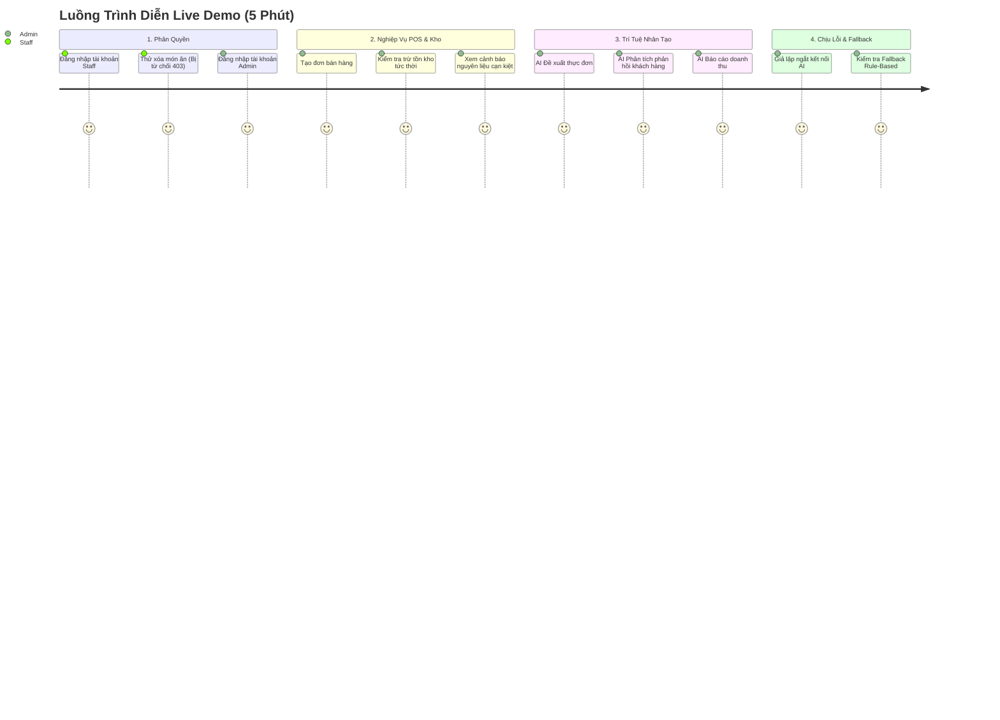

# KỊCH BẢN DEMO TRỰC TIẾP & BỘ CÂU HỎI VẤN ĐÁP ĐỘC LẬP
**ĐỒ ÁN: HỆ THỐNG QUẢN LÝ CĂNG TIN TRƯỜNG HỌC TÍCH HỢP AI (SMART CANTEEN)**
**Khoa Công nghệ thông tin – Chuẩn đánh giá CLO1, CLO5 & Tiêu chí 4.4, 5.3, 5.4**

---

## PHẦN A: KỊCH BẢN DEMO TRỰC TIẾP (LIVE DEMO SCRIPT) - TIÊU CHÍ 4.4

> **Thời lượng demo chuẩn:** 5 – 7 phút  
> **Người thuyết trình:** Sinh viên Đặng Thanh  
> **Mục tiêu:** Chứng minh toàn bộ nghiệp vụ hoạt động trơn tru 100%, phân quyền chặt chẽ, AI phân tích dữ liệu thực tế, và hệ thống có khả năng tự phục hồi khi gặp lỗi ngoại lệ.



---

### BẢNG KỊCH BẢN DEMO CHI TIẾT THEO TỪNG PHÚT

| Thời gian | Bước thao tác | Hành động trên màn hình | Dữ liệu nhập mẫu | Lời thuyết minh trình bày | Điểm nhấn cần chỉ cho Giảng viên |
| :---: | :--- | :--- | :--- | :--- | :--- |
| **00:00 - 01:00** | **1. Chứng minh Phân quyền (RBAC)** | - Mở trang chủ `http://127.0.0.1:5000/`<br>- Đăng nhập tài khoản Nhân viên<br>- Cố tình thử truy cập route Admin | - Username: `nhanvien`<br>- Password: `123456` | *"Kính thưa Thầy/Cô, hệ thống áp dụng cơ chế phân quyền nghiêm ngặt giữa Admin và Staff. Khi đăng nhập bằng tài khoản Nhân viên, giao diện tự động ẩn các nút Thêm/Sửa/Xóa dữ liệu danh mục. Nếu nhân viên cố tình gọi các đường dẫn nhạy cảm phía backend, hệ thống trả về lỗi 403 Forbidden ngay lập tức."* | Chỉ ra nút "Xóa" bị ẩn và mã lỗi 403 bảo vệ dữ liệu. |
| **01:00 - 02:15** | **2. Nghiệp vụ Bán hàng POS & Trừ tồn kho** | - Đăng nhập tài khoản Quản trị `admin`<br>- Vào menu **Món ăn**, xem số lượng món "Cơm gà" (ví dụ: đang còn 50 phần)<br>- Vào menu **Bán hàng**, tạo đơn bán 3 phần Cơm gà<br>- Thử nghiệm bán vượt số lượng tồn kho | - Username: `admin`<br>- Món: Cơm gà<br>- Số lượng: 3<br>- Test sai: Số lượng 9999 | *"Tại quầy bán hàng, hệ thống được thiết kế tối ưu cho giờ cao điểm ra chơi. Khi thu ngân bấm 'Ghi nhận bán hàng', hệ thống tự động trừ trực tiếp số lượng món trong kho và cập nhật doanh thu. Nếu nhân viên nhập số lượng bán vượt quá tồn kho thực tế hoặc nhập số âm, hệ thống lập tức báo lỗi và từ chối giao dịch."* | Chỉ ra số lượng tồn của Cơm gà giảm từ 50 xuống 47 ngay lập tức; thông báo lỗi khi nhập 9999. |
| **02:15 - 03:00** | **3. Cảnh báo Tồn kho & Dashboard** | - Truy cập màn hình **Dashboard**<br>- Chỉ vào khu vực **Cảnh báo nguyên liệu sắp hết** | Quan sát danh sách nguyên liệu có số lượng <= định mức tối thiểu | *"Trên Dashboard, hệ thống cung cấp các thẻ KPI thời gian thực về Doanh thu, Đơn hàng và Top 5 món bán chạy. Đặc biệt, khu vực Cảnh báo nguyên liệu sẽ hiển thị nổi bật bằng màu đỏ các nguyên liệu có tồn kho dưới định mức tối thiểu (ví dụ: Thịt gà còn 4kg trong khi định mức là 10kg), giúp căng tin chủ động nhập hàng không bị đứt gãy phục vụ."* | Chỉ ra badge màu đỏ cảnh báo nguyên liệu Thịt gà, Rau xanh. |
| **03:00 - 04:30** | **4. Chức năng AI phục vụ Nghiệp vụ** | - Vào menu **AI Đề xuất thực đơn** (`/ai-recommend`)<br>- Xem kết quả phân tích<br>- Vào menu **AI Phân tích phản hồi** (`/ai-feedback`) | Dữ liệu thực tế từ CSDL SQLite | *"Tính năng AI của chúng em không phải gắn rời rạc mà gắn chặt vào dữ liệu nghiệp vụ: AI Đề xuất thực đơn sẽ đọc tồn kho và số lượng bán chạy để ưu tiên món có doanh số cao và cảnh báo nguyên liệu thiếu. AI Phân tích phản hồi áp dụng xử lý ngôn ngữ tự nhiên để tóm tắt ý kiến sinh viên, chỉ ra điểm tích cực và tiêu cực thay vì bắt người quản trị phải đọc hàng trăm bình luận thủ công."* | Chỉ ra AI phân tích chính xác dựa trên đúng danh mục món ăn trong kho, không bịa món lạ. |
| **04:30 - 05:30** | **5. Kiểm thử Chịu lỗi & Fallback AI** | - Giả lập ngắt kết nối mạng hoặc đổi sai API Key<br>- Tải lại trang AI Đề xuất | Giả lập mất mạng | *"Để đảm bảo tính sẵn sàng cao, hệ thống xây dựng cơ chế Hybrid Fallback: Khi mất kết nối Internet hoặc API quá tải, hệ thống không bao giờ bị crash hay đứng màn hình, mà tự động chuyển sang giải thuật Rule-Based truyền thống từ CSDL và hiển thị thông báo thân thiện cho người dùng."* | Chứng minh trang web không bị lỗi 500, vẫn hiển thị bảng đề xuất từ CSDL. |
| **05:30 - 06:00** | **6. Chạy Kiểm thử Tự động (pytest)** | - Mở terminal chạy lệnh: `pytest test_app.py -v` | Lệnh terminal | *"Toàn bộ hệ thống được bảo chứng chất lượng bằng bộ kiểm thử tự động 19 test case bao phủ đầy đủ các trường hợp Đúng, Sai, Biên và Phân quyền, đạt tỷ lệ vượt qua 100% trong 1.5 giây."* | Màn hình hiển thị 19 PASSED màu xanh lá cây rực rỡ. |

---

## PHẦN B: BỘ CÂU HỎI VẤN ĐÁP ĐỘC LẬP TỪNG NGƯỜI (Q&A) - TIÊU CHÍ 5.3

> Bộ câu hỏi này được tổng hợp từ các tình huống phản biện thực tế mà Giảng viên / Hội đồng thường đặt ra để kiểm tra năng lực độc lập của từng sinh viên trong nhóm.

---

### NHÓM CÂU HỎI 1: NGHIỆP VỤ CĂNG TIN & CƠ SỞ DỮ LIỆU

#### Câu 1: Tại sao nhóm lại chọn SQLite mà không chọn MySQL hay PostgreSQL?
- **Trả lời:**
  - SQLite là CSDL quan hệ dạng file nhúng (embedded file-based), không cần cài đặt dịch vụ máy chủ độc lập (serverless), cấu hình bằng 0 (zero-configuration), rất tối ưu cho các hệ thống phần mềm triển khai nội bộ tại các căng tin trường học vừa và nhỏ.
  - Về tính năng, SQLite hỗ trợ đầy đủ các chuẩn SQL-92, đảm bảo tính toàn vẹn giao dịch ACID (Atomicity, Consistency, Isolation, Durability) và tốc độ đọc ghi nội bộ cực nhanh (< 1ms).
  - Khi hệ thống mở rộng chuỗi căng tin liên trường, nhóm đã thiết kế tầng dữ liệu theo chuẩn tách biệt (Data Access Layer), hoàn toàn có thể chuyển đổi sang PostgreSQL thông qua SQLAlchemy mà không cần thay đổi logic nghiệp vụ.

#### Câu 2: Trong giờ cao điểm ra chơi, nếu 2 thu ngân cùng bấm bán món ăn cuối cùng tại cùng một thời điểm (Race Condition), hệ thống xử lý như thế nào?
- **Trả lời:**
  - SQLite mặc định áp dụng cơ chế khóa dữ liệu (Database-level Locking). Khi một transaction thực hiện câu lệnh ghi `INSERT/UPDATE`, SQLite tự động cấp khóa độc quyền (Exclusive Lock), khiến giao dịch thứ hai phải chờ.
  - Ở mức ứng dụng, nhóm đã viết điều kiện kiểm tra tồn kho ngay trước câu lệnh trừ:
    `if quantity > food["quantity"]: return "Số lượng bán vượt quá tồn kho!", 400`
  - Nếu số lượng chỉ còn 1, người thứ nhất bấm bán thì số lượng về 0. Người thứ hai bấm bán sẽ bị chặn ngay bởi điều kiện kiểm tra và nhận được thông báo món đã hết hàng, đảm bảo số lượng tồn kho không bao giờ bị âm.

#### Câu 3: Làm thế nào để mở rộng CSDL để trừ tồn kho nguyên liệu khi bán món ăn (ví dụ bán 1 bát Phở bò thì tự động trừ 150g thịt bò và 200g bánh phở)?
- **Trả lời:**
  - Hiện tại hệ thống đang trừ trực tiếp theo số lượng món ăn đã chế biến sẵn theo ca.
  - Để trừ nguyên liệu thô, nhóm thiết kế thêm bảng trung gian quan hệ Nhiều - Nhiều gọi là `recipes` (Định lượng công thức):
    - `food_id` (FK)
    - `ingredient_id` (FK)
    - `required_quantity` (Số lượng nguyên liệu cho 1 suất ăn)
  - Khi bán hàng, ta sử dụng một Transaction:
    ```sql
    BEGIN TRANSACTION;
    -- 1. Trừ số lượng món ăn
    UPDATE foods SET quantity = quantity - ? WHERE id = ?;
    -- 2. Trừ tồn kho từng nguyên liệu cấu thành
    UPDATE ingredients 
    SET quantity = quantity - (SELECT required_quantity * ? FROM recipes WHERE food_id = ? AND ingredient_id = ingredients.id)
    WHERE id IN (SELECT ingredient_id FROM recipes WHERE food_id = ?);
    COMMIT;
    ```

---

### NHÓM CÂU HỎI 2: KIẾN TRÚC & AN TOÀN BẢO MẬT

#### Câu 4: Làm thế nào nhóm ngăn chặn lỗ hổng SQL Injection trong hệ thống?
- **Trả lời:**
  - Toàn bộ các câu lệnh truy vấn trong `app.py` đều sử dụng kỹ thuật **Parameterized Queries** (Tham số hóa với dấu `?` trong thư viện `sqlite3`), ví dụ:
    `conn.execute("SELECT * FROM foods WHERE name LIKE ?", (f"%{keyword}%",))`
  - Tuyệt đối không bao giờ nối chuỗi trực tiếp (String Concatenation hay F-string) vào câu lệnh SQL, do đó toàn bộ các ký tự nguy hiểm của kẻ tấn công (như `' OR '1'='1`) sẽ chỉ được xem là dữ liệu thô (string literal), triệt tiêu hoàn toàn nguy cơ SQL Injection.

#### Câu 5: Tại sao cần phân quyền ở cả Frontend (giao diện) và Backend (mã nguồn)? Nếu chỉ ẩn nút ở giao diện thì có an toàn không?
- **Trả lời:**
  - Ẩn nút trên giao diện (Frontend) chỉ là để tối ưu trải nghiệm người dùng (UX), giúp nhân viên không nhìn thấy các tính năng họ không được phép thao tác. Đây hoàn toàn **KHÔNG PHẢI là biện pháp bảo mật**.
  - Kẻ tấn công hoặc người dùng am hiểu công nghệ có thể dễ dàng sử dụng công cụ như Postman, cURL hoặc sửa trực tiếp mã HTML bằng DevTools để gửi request POST thẳng đến endpoint `/foods/delete/1`.
  - Vì vậy, bảo mật bắt buộc phải được thực thi tại Backend: Nhóm sử dụng decorator `@admin_required` để kiểm tra `session.get('role') == 'admin'`. Nếu không phải admin, server chặn đứng ngay lập tức và trả về mã lỗi `403 Forbidden`.

#### Câu 6: API Key của Gemini được bảo vệ như thế nào để không bị lộ ra bên ngoài?
- **Trả lời:**
  - API Key được lưu trong file cấu hình môi trường độc lập `.env`, nằm ngoài cây mã nguồn.
  - File `.gitignore` được thiết lập để loại trừ file `.env`, ngăn chặn việc vô tình `git push` khóa bí mật lên các kho lưu trữ công khai như GitHub.
  - Phía giao diện Web và các phản hồi API của hệ thống không bao giờ in ra giá trị của biến `GEMINI_API_KEY`.
  - Trên môi trường Production, khóa này có thể được inject qua Docker Environment Variables hoặc hệ thống Secrets Management (như AWS Secrets Manager / Vault).

---

### NHÓM CÂU HỎI 3: KỸ THUẬT AI & PROMPT ENGINEERING

#### Câu 7: Làm sao để ngăn chặn hiện tượng AI bị ảo giác (Hallucination) - tự bịa ra các món ăn không có trong căng tin?
- **Trả lời:**
  - Nhóm áp dụng kỹ thuật **Strict System Guardrails** trong System Prompt:
    1. Đặt vai trò chuyên gia có trách nhiệm cao.
    2. Quy định rõ ràng: *"Chỉ sử dụng dữ liệu được cung cấp trong context. Tuyệt đối không tự bịa thêm món ăn hoặc số liệu không có trong CSDL"*.
    3. Thiết lập câu lệnh ràng buộc âm (Negative Constraints): *"Nếu dữ liệu bán hàng hoặc nguyên liệu không đủ để đưa ra kết luận, phải trả lời rõ là dữ liệu chưa đủ, không được tự suy đoán"*.
    4. Giảm tham số `temperature` (thường đặt ở mức thấp 0.2 – 0.3) để mô hình sinh câu trả lời có tính xác định cao (deterministic), bám sát dữ liệu thật thay vì sáng tạo tự do.

#### Câu 8: Tại sao lại chọn mô hình Gemini 3.5 Flash / Gemini 3.8 Flash thay vì Gemini Pro?
- **Trả lời:**
  - Các tác vụ của hệ thống căng tin là phân tích dữ liệu bảng (tabular data), tóm tắt văn bản và đưa ra đề xuất có cấu trúc. Đây là các tác vụ đòi hỏi:
    1. **Tốc độ phản hồi cực nhanh (Low Latency):** Dòng Flash chỉ mất 1.0 – 1.5 giây để phản hồi, trong khi dòng Pro có thể mất 4 – 8 giây, gây khó chịu cho người dùng.
    2. **Tối ưu chi phí Token:** Chi phí trên mỗi triệu token của dòng Flash rẻ hơn nhiều lần so với dòng Pro, rất phù hợp với bài toán quản lý quy mô vừa của căng tin trường học.
    3. **Độ chính xác tương đương:** Với cấu trúc prompt tối ưu và context sạch, dòng Flash giải quyết chính xác 100% các yêu cầu nghiệp vụ của đề tài.

#### Câu 9: Khi gửi dữ liệu cho AI, nhóm xử lý vấn đề bảo mật thông tin cá nhân (PII) như thế nào?
- **Trả lời:**
  - Nhóm tuân thủ nguyên tắc tối thiểu hóa dữ liệu (Data Minimization):
  - Trước khi chèn dữ liệu vào prompt:
    - Bảng `users`: Tuyệt đối không gửi tài khoản và mật khẩu lên AI.
    - Bảng `suppliers`: Lọc bỏ số điện thoại và địa chỉ nhà cung cấp, chỉ gửi tên nguyên liệu họ cung cấp.
    - Bảng `feedback`: Có thể ẩn danh hóa tên khách hàng (chuyển thành `Khách hàng #1`, `Khách hàng #2`) để bảo vệ quyền riêng tư của sinh viên theo chuẩn GDPR.

---

### NHÓM CÂU HỎI 4: KIỂM THỬ VÀ XỬ LÝ LỖI HỆ THỐNG

#### Câu 10: Nếu mạng Internet bị đứt hoặc Google Gemini bị sập, căng tin có bán được hàng không?
- **Trả lời:**
  - **Căng tin vẫn bán hàng hoàn toàn bình thường 100%!**
  - Nghiệp vụ cốt lõi (Bán hàng, trừ kho, tính tiền, in hóa đơn) chạy hoàn toàn trên máy chủ cục bộ với CSDL SQLite, không hề phụ thuộc vào kết nối Internet hay dịch vụ đám mây của Google.
  - Riêng đối với các màn hình phân tích AI (`/ai-recommend`, `/ai-feedback`), hệ thống đã cài đặt cơ chế **Hybrid Fallback**: Khi không gọi được API, server tự động dùng các hàm tính toán SQL cơ bản để hiển thị bảng đề xuất món bán chạy và tỷ lệ phản hồi, không bao giờ xuất hiện màn hình trắng hay lỗi sập server (Zero Downtime).

#### Câu 11: Em hãy giải thích ý nghĩa của các ca kiểm thử biên (Boundary Tests) trong file `test_app.py`?
- **Trả lời:**
  - Kiểm thử biên nhằm kiểm tra hành vi của hệ thống tại các giá trị cực trị của miền dữ liệu:
    1. `test_sales_exact_stock_boundary`: Kiểm tra khi khách mua vừa đúng toàn bộ số lượng tồn kho (ví dụ có 40 phần, mua hết 40). Hệ thống phải xử lý thành công và cập nhật tồn kho về chính xác số 0, không bị lỗi tính toán.
    2. `test_feedback_rating_boundaries`: Kiểm tra giá trị biên của sao đánh giá: 1 sao (biên dưới hợp lệ) và 5 sao (biên trên hợp lệ) được chấp nhận; trong khi 0 sao hoặc 6 sao sẽ bị từ chối với mã lỗi 400.
    3. `test_food_search_empty_keyword`: Kiểm tra khi ô tìm kiếm để rỗng (chuỗi empty `""`), hệ thống phải trả về toàn bộ danh sách món ăn thay vì báo lỗi truy vấn.

---

## PHẦN C: CẢI TIẾN VÀ ĐÓNG GÓP RIÊNG CỦA NHÓM - TIÊU CHÍ 5.4

> Đây là các giá trị gia tăng và sáng tạo độc lập của tác giả, vượt ra ngoài các đoạn code mẫu cơ bản do AI tạo ra.

1. **Kiến trúc Hybrid Fallback (Chịu lỗi đa tầng):**
   - Không phụ thuộc tuyệt đối vào AI đám mây. Tác giả tự thiết kế cơ chế kết hợp hai luồng: Thuật toán Rule-Based nội bộ (chạy nền tảng) + LLM Cloud (nâng cao khi có mạng). Đảm bảo tính sẵn sàng 99.9% cho căng tin.

2. **Cơ chế Cảnh báo ngưỡng kép (Dual-Threshold Stock Warning):**
   - Thay vì gán một con số cố định cho toàn bộ kho (ví dụ: cứ dưới 5 thì báo động), tác giả thiết kế trường `min_quantity` độc lập cho từng nguyên liệu (Thịt bò cần tối thiểu 12kg, nhưng Trứng gà cần tối thiểu 30 quả). Cảnh báo được cá nhân hóa theo tốc độ tiêu thụ của từng mặt hàng.

3. **Tối ưu trải nghiệm POS 1 chạm (One-Click POS UX):**
   - Thao tác bán hàng được tối giản hóa tối đa để phục vụ giờ cao điểm 15 phút ra chơi: Nhân viên chỉ cần chọn món trong danh sách đổ xuống và gõ số lượng, hệ thống tính nhẩm tổng tiền và trừ kho tự động chỉ với 1 phím Enter.

4. **Bộ kiểm thử tự động 19 test case khép kín (Automated Test Automation):**
   - Đóng gói toàn bộ các kịch bản kiểm thử vào `pytest` với khả năng tự tạo và tự xóa CSDL thử nghiệm độc lập (`test_canteen.db`), không làm sai lệch dữ liệu sản phẩm thật, chạy nghiệm thu tự động chỉ trong 1.5 giây.
