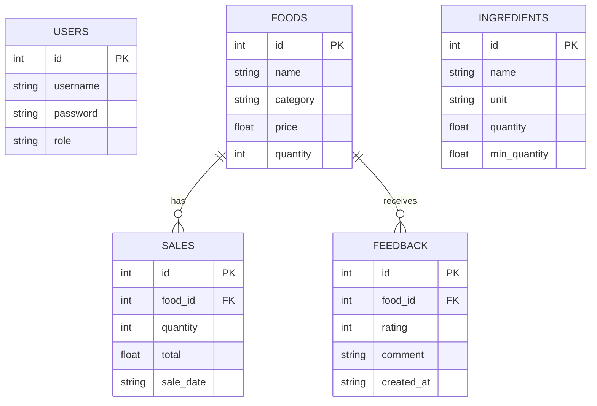

# THIẾT KẾ CƠ SỞ DỮ LIỆU & KIẾN TRÚC HỆ THỐNG

## 1. Thiết kế Cơ sở dữ liệu (Database Design)

Hệ thống sử dụng **SQLite**, một CSDL quan hệ nhỏ gọn.

### 1.1. Các bảng dữ liệu (Tables)

**Bảng `users` (Tài khoản)**
- `id` (INTEGER, PK, AI): Mã tài khoản
- `username` (TEXT, UNIQUE): Tên đăng nhập
- `password` (TEXT): Mật khẩu (Nên hash ở thực tế)
- `role` (TEXT): Vai trò (`admin`, `staff`)

**Bảng `foods` (Món ăn)**
- `id` (INTEGER, PK, AI): Mã món
- `name` (TEXT): Tên món
- `category` (TEXT): Phân loại (Cơm, Nước, Ăn nhanh...)
- `price` (REAL): Giá tiền
- `quantity` (INTEGER): Số lượng món có sẵn
- `status` (TEXT): Trạng thái (Đang bán, Ngừng bán)

**Bảng `ingredients` (Nguyên liệu)**
- `id` (INTEGER, PK, AI): Mã nguyên liệu
- `name` (TEXT): Tên nguyên liệu
- `unit` (TEXT): Đơn vị tính (kg, quả, lít...)
- `quantity` (REAL): Số lượng tồn
- `min_quantity` (REAL): Định mức tối thiểu cảnh báo

**Bảng `suppliers` (Nhà cung cấp)**
- `id` (INTEGER, PK, AI): Mã NCC
- `name` (TEXT): Tên NCC
- `phone` (TEXT): Số ĐT
- `address` (TEXT): Địa chỉ

**Bảng `sales` (Giao dịch bán hàng)**
- `id` (INTEGER, PK, AI): Mã giao dịch
- `food_id` (INTEGER, FK): Liên kết bảng `foods`
- `quantity` (INTEGER): Số lượng bán
- `total` (REAL): Tổng tiền
- `sale_date` (TEXT): Ngày bán

**Bảng `feedback` (Phản hồi)**
- `id` (INTEGER, PK, AI): Mã phản hồi
- `food_id` (INTEGER, FK): Món ăn bị đánh giá
- `customer_name` (TEXT): Tên khách
- `rating` (INTEGER): Sao (1-5)
- `comment` (TEXT): Bình luận
- `created_at` (TEXT): Ngày gửi

### 1.2. Sơ đồ ERD

## 2. Thiết kế kiến trúc hệ thống

- **Mô hình kiến trúc**: Server-Side Rendering (SSR) kết hợp RESTful API cho AI.
- **Frontend Layer**:
  - Công nghệ: HTML5, CSS (Bootstrap), Jinja2 Templates.
  - Chức năng: Render giao diện, tiếp nhận thao tác của người dùng (forms, buttons) và gửi HTTP request (GET/POST) về server.
- **Backend Layer (Application Layer)**:
  - Công nghệ: Python Flask.
  - Chức năng: Routing (chỉ đường), Controllers (xử lý logic nghiệp vụ, xác thực), Services (chuẩn bị dữ liệu để gọi AI).
- **Data Layer**:
  - Công nghệ: SQLite.
  - Chức năng: Lưu trữ toàn bộ dữ liệu quản lý.
- **AI Service Layer**:
  - Công nghệ: Google Gemini API.
  - Luồng dữ liệu: Backend lấy dữ liệu từ SQLite (ví dụ: top món bán chạy), biến đổi thành chuỗi JSON/String, đưa vào Prompt và gọi API HTTP đến Google Gemini. Nhận kết quả Text và render ra giao diện.

## 3. Thiết kế Prompt và Luồng gọi AI

### Luồng gọi AI sơ bộ
1. Người dùng bấm nút "Nhận đề xuất AI".
2. Flask Backend query CSDL: Lấy danh sách tồn kho nguyên liệu và top 5 món bán chạy nhất tuần.
3. Flask ghép dữ liệu vào `USER_PROMPT`.
4. Gọi hàm `model.generate_content(prompt)` qua `google-generativeai`.
5. Bắt lỗi (try-catch) nếu timeout hoặc sai API Key.
6. Xử lý chuỗi kết quả và truyền qua Jinja template để hiển thị.

### Prompt Mẫu (Gợi ý thực đơn)
**System Prompt:**
> Bạn là một chuyên gia quản lý căng tin trường học. Nhiệm vụ của bạn là đưa ra một thực đơn gợi ý cho ngày mai dựa trên các thông tin tồn kho và lịch sử bán hàng được cung cấp. Phân tích phải logic, rõ ràng, khuyên nên đẩy mạnh món gì và hạn chế món gì. Đầu ra định dạng markdown dễ đọc.

**User Prompt:**
> Dưới đây là dữ liệu kinh doanh của căng tin hôm nay:
> - Danh sách món ăn và tồn kho: {food_data}
> - Danh sách nguyên liệu và tồn kho: {ingredient_data}
> - Danh sách món bán chạy: {sales_data}
> Dựa vào dữ liệu trên, hãy đề xuất 3 món ăn nên ưu tiên bán vào ngày mai và giải thích lý do cụ thể. Cảnh báo nếu có nguyên liệu nào sắp hết.
